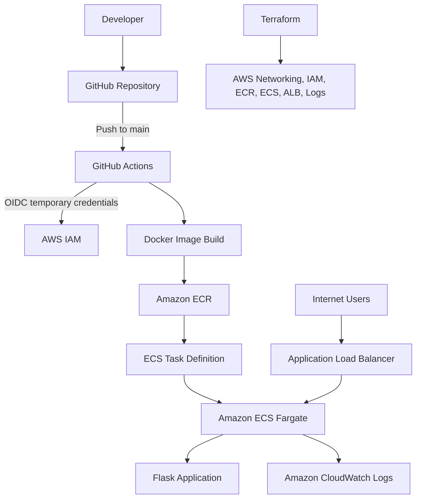

# End-to-End CI/CD Pipeline on AWS with GitHub Actions, Docker, ECS Fargate & Terraform

> A hands-on DevOps project that provisions AWS infrastructure with Terraform and automatically builds and deploys a Python Flask application to Amazon ECS Fargate using GitHub Actions and secure OIDC authentication.

**Repository:** [abiyecomgit/CICD-ECS-PROJECT](https://github.com/abiyecomgit/CICD-ECS-PROJECT)  
**AWS Region:** `us-west-2` (Oregon)  
**Application:** Python / Flask / Gunicorn  
**Deployment:** Amazon ECS on AWS Fargate

## Table of Contents

1. [Project Overview](#project-overview)
2. [Architecture and Service Connections](#architecture-and-service-connections)
3. [Technologies](#technologies)
4. [Repository Structure](#repository-structure)
5. [Prerequisites](#prerequisites)
6. [Step-by-Step Implementation](#step-by-step-implementation)
7. [CI/CD Workflow](#cicd-workflow)
8. [Verification and Testing](#verification-and-testing)
9. [Security Practices](#security-practices)
10. [Troubleshooting](#troubleshooting)
11. [Cleanup](#cleanup)
12. [Lessons Learned](#lessons-learned)

## Project Overview

This project demonstrates an automated software delivery workflow. I developed and tested a Flask application locally, packaged it as a Docker image, and deployed it to an ECS Fargate service behind an Application Load Balancer (ALB). Terraform manages the AWS infrastructure, while GitHub Actions builds and redeploys the application whenever changes are pushed to the `main` branch.

GitHub Actions uses **OpenID Connect (OIDC)** to request temporary AWS credentials instead of storing long-lived AWS access keys.

### Objectives

- Build and test a Flask application locally.
- Package the application in a Docker image running as a non-root user.
- Provision networking, IAM, ECR, ECS, ALB, and CloudWatch using Terraform.
- Run ECS Fargate tasks in private subnets, reachable through a public ALB.
- Automate image builds and deployments through GitHub Actions.
- Verify health checks, deployments, logging, and application availability.
- Safely remove infrastructure when no longer required.

## Architecture and Service Connections

### Application delivery



### Network layout

```text
AWS Region: us-west-2
└── VPC
    ├── Public subnet A (us-west-2a)
    ├── Public subnet B (us-west-2b)
    │   └── Internet-facing Application Load Balancer
    ├── Private subnet A (us-west-2a)
    ├── Private subnet B (us-west-2b)
    │   └── ECS Fargate application tasks
    ├── Internet Gateway (public routing)
    ├── NAT Gateway (private-subnet outbound access)
    └── Security groups (restrict network traffic)
```

**How the components work together:** Terraform provisions the infrastructure. GitHub stores the code and triggers GitHub Actions. GitHub Actions assumes an IAM role through OIDC, builds a Docker image, and pushes it to ECR. ECS launches Fargate tasks using the image. The public ALB routes incoming requests to healthy tasks in private subnets. CloudWatch collects application logs.

## Technologies

| Technology | Role |
|---|---|
| Python, Flask, Gunicorn | Application and web server |
| Docker | Build and run container images |
| Git and GitHub | Version control and source hosting |
| GitHub Actions | CI/CD automation |
| GitHub OIDC and AWS IAM | Temporary authentication and access control |
| Terraform | Infrastructure as Code |
| AWS CLI | AWS authentication and verification |
| Amazon VPC | Networking, subnets, gateways, and routing |
| Amazon ECR | Private container image registry |
| Amazon ECS Fargate | Serverless container execution |
| Application Load Balancer | Public application entry point and health checks |
| Amazon CloudWatch | Centralized application logs |

## Repository Structure

```text
CICD-ECS-PROJECT/
├── .github/
│   └── workflows/
│       └── deploy.yml
├── terraform/
│   ├── .terraform.lock.hcl
│   ├── alb.tf
│   ├── ecr.tf
│   ├── ecs.tf
│   ├── github-actions.tf
│   ├── iam.tf
│   ├── logs.tf
│   ├── networking.tf
│   ├── outputs.tf
│   ├── provider.tf
│   ├── security.tf
│   ├── variables.tf
│   └── versions.tf
├── .dockerignore
├── .gitignore
├── Dockerfile
├── app.py
├── requirements.txt
└── README.md
```

### Terraform file responsibilities

| File | Purpose |
|---|---|
| `versions.tf` | Terraform and provider version requirements |
| `provider.tf` | AWS provider configuration for `us-west-2` |
| `variables.tf` | Reusable input variables |
| `networking.tf` | VPC, public/private subnets, gateways, routes |
| `security.tf` | ALB and ECS security groups and rules |
| `ecr.tf` | ECR repository and lifecycle settings |
| `iam.tf` | ECS execution and task roles |
| `logs.tf` | CloudWatch log group |
| `alb.tf` | Load balancer, target group, listener |
| `ecs.tf` | ECS cluster, task definition, Fargate service |
| `github-actions.tf` | GitHub OIDC provider and deployment role |
| `outputs.tf` | Infrastructure identifiers and application URL |

## Prerequisites

Install and configure **Git**, **Python 3**, **Docker Desktop**, **AWS CLI**, and **Terraform**. Use an AWS identity with permissions to create the resources defined in the Terraform configuration. AWS services used here can incur charges.

```bash
python3 --version
docker --version
aws --version
terraform --version
git --version
aws configure get region
aws sts get-caller-identity
```

The configured AWS region for this project is `us-west-2`. Never commit AWS access keys, passwords, Terraform state, or `.env` files.

## Step-by-Step Implementation

### Stage 1 — Clone and test the Flask application

**1. Clone the repository.** This provides the application, Dockerfile, Terraform configuration, and GitHub Actions workflow.

```bash
git clone https://github.com/abiyecomgit/CICD-ECS-PROJECT.git
cd CICD-ECS-PROJECT
```

**2. Create a Python environment and install dependencies.** A virtual environment isolates the application's Python packages.

```bash
python3 -m venv .venv
source .venv/bin/activate
python3 -m pip install -r requirements.txt
pip show Flask
pip show gunicorn
```

**3. Run and verify the application locally.** This checks application behavior before containerization.

```bash
python3 app.py
```

Visit `http://localhost:5000` and expect **Hello from CI/CD Pipeline!**. In another terminal, check:

```bash
curl http://localhost:5000/health
```

The documented health response includes `application: cicd-ecs-project`, `aws_region: us-west-2`, and `status: healthy`. Stop the development server with **Ctrl+C**.

### Stage 2 — Build and test the Docker image

**4. Build the image.** Docker packages the application and its dependencies into a portable artifact.

```bash
docker build -t cicd-ecs-app:local .
docker images cicd-ecs-app
```

**5. Run and inspect the container.** Port `3000` on the laptop forwards to port `5000` inside the container.

```bash
docker run -d \
  --name cicd-ecs-container \
  -p 3000:5000 \
  cicd-ecs-app:local

docker ps
curl http://localhost:3000/health
docker logs cicd-ecs-container
docker exec cicd-ecs-container whoami
```

Open `http://localhost:3000`. The documented container user is `appuser`, demonstrating non-root execution.

**6. Remove the test container.** This leaves the built image available locally.

```bash
docker stop cicd-ecs-container
docker rm cicd-ecs-container
```

### Stage 3 — Initialize and validate Terraform

**7. Enter the Terraform directory and initialize it.** `init` downloads required providers and prepares the working directory.

```bash
cd terraform
terraform init
terraform fmt
terraform fmt -check
terraform validate
```

Expected validation message: `Success! The configuration is valid.`

### Stage 4 — Provision AWS infrastructure

**8. Create the initial infrastructure plan with zero ECS tasks.** At this point, the first image may not yet exist in ECR, so `desired_count=0` avoids attempting to start a task with a missing image.

```bash
terraform plan -var="desired_count=0" -out=tfplan
terraform apply tfplan
```

Terraform provisions the VPC, subnets, Internet/NAT Gateways, route tables, security groups, ECR repository, ECS cluster and service, ALB, IAM roles, and CloudWatch logging.

**9. Inspect the deployed resources.** This confirms Terraform has tracked the expected infrastructure.

```bash
terraform state list
terraform output
```

Typical outputs include `aws_region`, `vpc_id`, `ecr_repository_url`, `ecs_cluster_name`, `ecs_service_name`, `alb_dns_name`, and `application_url`.

**Console verification:** In AWS region **Oregon (`us-west-2`)**, review VPC networking, ECR repositories, ECS clusters/services/task definitions, EC2 load balancers and target groups, IAM roles, and CloudWatch log groups.

### Stage 5 — Configure GitHub Actions access to AWS

**10. Create the GitHub environment.** Navigate to **Repository → Settings → Environments → New environment**, and create `production`.

**11. Configure the following environment variables** under the `production` environment:

| Variable | Value |
|---|---|
| `AWS_REGION` | `us-west-2` |
| `ECR_REPOSITORY` | `cicd-ecs-app` |
| `ECS_CLUSTER` | `cicd-ecs-project-cluster` |
| `ECS_SERVICE` | `cicd-ecs-project-service` |
| `CONTAINER_NAME` | `cicd-ecs-app` |
| `AWS_ROLE_ARN` | IAM role ARN from Terraform output |

Retrieve the role ARN from the `terraform/` directory:

```bash
terraform output -raw github_actions_role_arn
```

**12. Verify the OIDC trust relationship.** The IAM role must permit `sts:AssumeRoleWithWebIdentity` and its trust policy must match the actual GitHub repository/environment `sub` claim. This allows GitHub Actions to obtain short-lived credentials without storing AWS secrets.

### Stage 6 — Trigger automated deployment

**13. Commit and push your code.** The workflow in `.github/workflows/deploy.yml` triggers on pushes to `main`.

```bash
# From the repository root
git status
git add .
git commit -m "Add CI/CD pipeline"
git push origin main
```

> Run `git commit` only when there are actual changes to commit. If you are replacing only this README, use `git add README.md` instead of `git add .`.

The GitHub Actions job checks out the repository, authenticates through OIDC, builds an `linux/amd64` image, tags it with the Git commit SHA, pushes it to ECR, updates the ECS task definition, deploys the ECS service, and waits for service stability.

## CI/CD Workflow

**Workflow file:** `.github/workflows/deploy.yml`  
**Trigger:** Push to `main`  
**GitHub environment:** `production`

```text
Push to main
    ↓
GitHub Actions checkout
    ↓
Assume AWS IAM role using OIDC
    ↓
Build Docker image (linux/amd64)
    ↓
Tag with Git commit SHA and push to ECR
    ↓
Update and register ECS task definition
    ↓
Update ECS service to the new revision
    ↓
Wait for stable ECS deployment
    ↓
Application available through the ALB
```

The workflow source of truth is the committed `.github/workflows/deploy.yml` file. The original project documentation describes use of `actions/checkout@v4`, `aws-actions/configure-aws-credentials@v6`, `aws-actions/amazon-ecr-login@v2`, and `aws-actions/amazon-ecs-render-task-definition@v1`.

**Why commit SHA tags matter:** Every image is tied to a specific code revision, making deployments traceable. The ECR configuration described in the project also includes image scanning, AES256 encryption, immutable tags, and an image lifecycle policy.

## Verification and Testing

### 1. GitHub Actions

Open **GitHub → CICD-ECS-PROJECT → Actions**. Confirm that checkout, AWS authentication, ECR login, image build/push, task definition registration, ECS service update, and stability checks all succeeded.

### 2. Amazon ECR

Open **AWS Console → ECR → Repositories → `cicd-ecs-app`**. Confirm an image exists with a Git commit SHA tag.

### 3. Amazon ECS

Open **AWS Console → ECS → Clusters → `cicd-ecs-project-cluster` → Services → `cicd-ecs-project-service`**. After a successful deployment, the documented target is **desired tasks: 1 / running tasks: 1**. Confirm a newer task definition revision was registered.

### 4. ALB target health

Open **EC2 → Target Groups → `cicd-ecs-tg` → Targets**. Confirm the application target is **Healthy**. The health check endpoint is `/health`.

### 5. Public application

From the `terraform/` directory:

```bash
terraform output -raw application_url
```

Open the URL returned by Terraform. The documented homepage displays **Hello from CI/CD Pipeline!**. Test the `/health` endpoint on the same host.

### 6. Prove continuous deployment

Update the homepage text in `app.py`, then commit and push:

```bash
git add app.py
git commit -m "Update application homepage"
git push origin main
```

Watch the GitHub Actions run. After it succeeds, refresh the ALB URL. Seeing the new text confirms the application was automatically rebuilt and redeployed without a manual Docker push or ECS deployment command.

## Security Practices

- Use **GitHub OIDC** and short-lived AWS credentials rather than permanent access keys in GitHub.
- Restrict the IAM role trust policy to the intended GitHub repository and `production` environment.
- Run ECS Fargate tasks in **private subnets**, behind a public ALB.
- Allow application ingress to ECS only from the ALB security group.
- Run the Docker application as a **non-root user**.
- Enable ECR image scanning, encryption, immutable tags, and image lifecycle policies.
- Tag images with unique Git commit SHAs.
- Keep `.env`, local virtual environments, Terraform state, and generated plans out of Git.
- Use CloudWatch for centralized application logging.

### Recommended `.gitignore` entries

```gitignore
# Python
__pycache__/
*.py[cod]
.pytest_cache/
.venv/
venv/

# Secrets and local configuration
.env
*.env

# Local editor / OS
.DS_Store
.vscode/

# Terraform local files and sensitive state
.terraform/
*.tfstate
*.tfstate.*
*.tfvars
*.tfvars.json
crash.log
override.tf
override.tf.json
*_override.tf
*_override.tf.json
tfplan
*.tfplan
```

Commit `.terraform.lock.hcl` to keep provider selections reproducible. Keep Terraform state in a protected location; do not upload state files to GitHub.

## Troubleshooting

| Issue | Cause or symptom | Resolution documented in this project |
|---|---|---|
| Virtual environment activation failed | `.venv/bin/activate` missing | Run `python3 -m venv .venv`, then `source .venv/bin/activate` |
| Git initialized in the wrong directory | Git root pointed at the home directory | Check `git rev-parse --show-toplevel` and use the correct project directory |
| Flask `NameError: app is not defined` | Flask app object missing before route definitions | Restore `app = Flask(__name__)` |
| Terraform ECR syntax error | Plain-language notes were interpreted as HCL | Prefix notes with `#` to make them comments |
| Terraform security group dependency cycle | ALB and ECS security groups referenced each other in a cycle | Separate security groups from ingress/egress rule resources |
| GitHub OIDC authentication denied | `sts:AssumeRoleWithWebIdentity` authorization failed | Verify role ARN, `id-token: write`, GitHub environment, token claims, and IAM trust-policy `sub` matching |

### Useful diagnostic commands

```bash
# Git
git status
git remote -v
git rev-parse --show-toplevel
git log --oneline

# Docker
docker images cicd-ecs-app
docker ps
docker logs cicd-ecs-container

# Terraform (run in terraform/)
terraform fmt -check
terraform validate
terraform state list
terraform output

# AWS
aws sts get-caller-identity
aws configure list
aws configure get region
```

## Cleanup

> **Cost awareness:** NAT Gateways, ALBs, ECS Fargate tasks, and other provisioned AWS services may incur charges. Destroy resources when the environment is no longer needed.

Only run these commands against the intended project and Terraform state. **Do not run them if the state has been lost or is pointing to a different environment.**

From the repository's `terraform/` directory:

**1. Review the destruction plan.**

```bash
terraform plan \
  -destroy \
  -var="github_repository=abiyecomgit/CICD-ECS-PROJECT" \
  -var="desired_count=0"
```

**2. Destroy the Terraform-managed infrastructure.**

```bash
terraform destroy \
  -var="github_repository=abiyecomgit/CICD-ECS-PROJECT" \
  -var="desired_count=0"
```

Review the planned resources carefully and type `yes` only if they belong to this project.

**3. Verify the cleanup.**

```bash
terraform state list
```

Check the AWS Console for remaining project-specific ECS services, ECR images/repositories, load balancers, NAT Gateways, CloudWatch log groups, and any resources not managed by Terraform. Review AWS Billing / Cost Explorer; historical charges may remain even after deletion.

## Lessons Learned

This project helped me connect the full DevOps delivery lifecycle: **GitHub tracks changes; GitHub Actions automates delivery; OIDC secures AWS authentication; Docker standardizes the application package; ECR stores images; ECS Fargate runs containers; the ALB exposes healthy tasks; Terraform makes infrastructure repeatable; and CloudWatch supports troubleshooting.**

I also gained practical experience resolving Terraform dependency errors, diagnosing GitHub OIDC trust-policy failures, validating deployments, and managing cloud costs through deliberate cleanup.

---

**Project repository:** [github.com/abiyecomgit/CICD-ECS-PROJECT](https://github.com/abiyecomgit/CICD-ECS-PROJECT)
